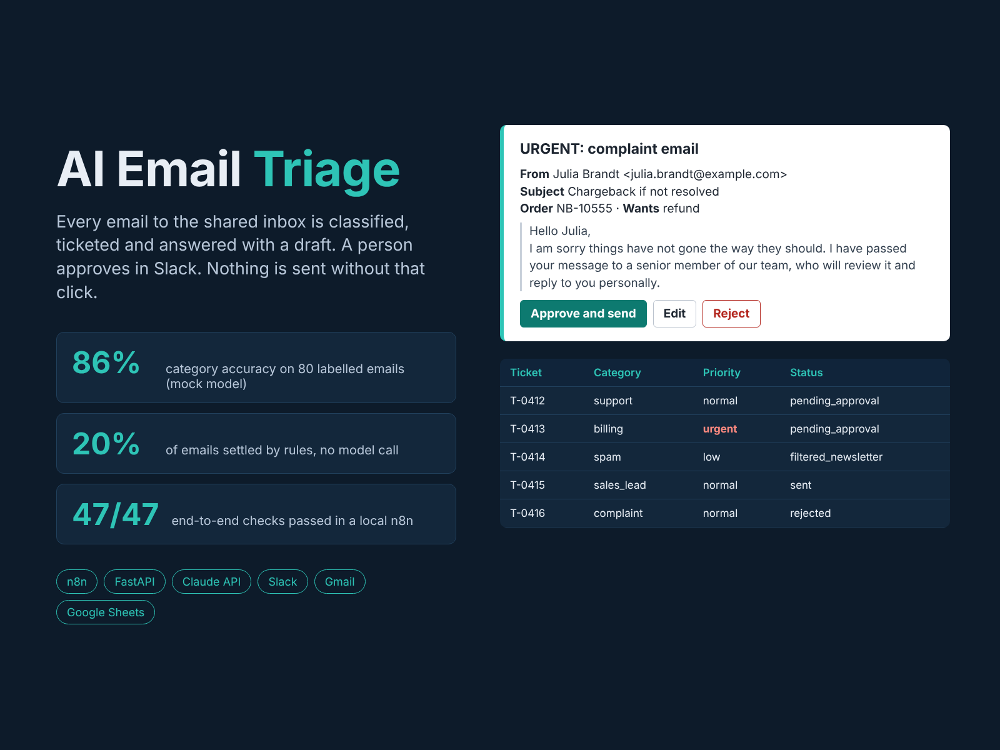
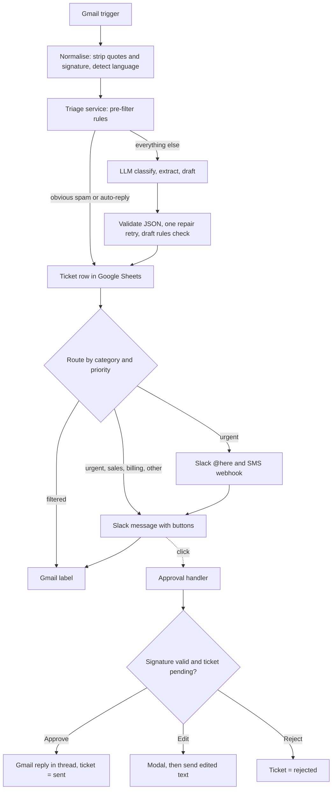
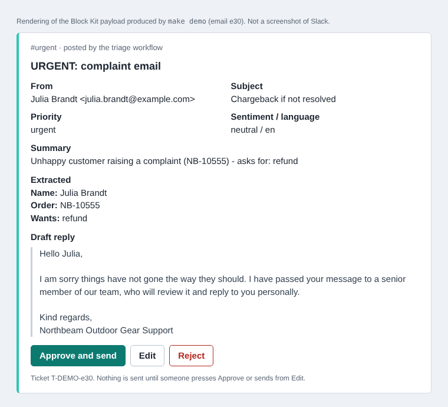

# AI Email Triage

Classifies every email that reaches a shared inbox, extracts the key details, drafts a reply, opens a ticket, and waits for a person to approve the reply in Slack before anything is sent.



## The problem

A small shop's support@ inbox mixes order questions, invoice problems, sales leads, angry customers and a lot of noise. Someone has to read all of it, decide what matters, and write similar replies again and again. Urgent messages (a chargeback threat, a stove leaking fuel) get buried between newsletters. Fully automatic replies are not an option, because one wrong promise of a refund costs real money.

## What it does

- Reads new Gmail messages, strips quoted history and signatures, and detects the language.
- Settles obvious spam, newsletters and auto-replies with rules, so they never reach the model.
- Classifies the rest (support, sales lead, billing, complaint, spam, other), sets a priority, and extracts name, company, order number, invoice number, product, requested action and deadline.
- Drafts a short, polite reply in the customer's language. The draft never promises refunds or dates and asks for whatever is missing.
- Writes a ticket row to Google Sheets and applies a Gmail label.
- Posts the summary, extracted fields and draft to Slack with Approve, Edit and Reject buttons, in a channel that depends on the category.
- Urgent mail gets an immediate @here mention and an SMS-ready webhook call.
- A second workflow verifies the Slack signature and sends the reply in the original thread only after someone clicks.
- A third workflow posts failures to Slack; a fourth posts a daily digest.

## How it works



The model call lives in a small FastAPI service (`triage/`), not in n8n. That keeps the prompt, the schema validation, the injection guard and the Slack message layout in code that has unit tests. n8n does the orchestration it is good at: triggers, routing, Gmail, Sheets and Slack.

## Results

Everything below was measured in this repo on the 80 synthetic emails in `data/emails.jsonl`. Reproduce it with `make test`, `make eval` and `make e2e`.

**Mock model.** The numbers are for the built-in keyword model, which is deliberately simple and was written alongside the dataset, so treat them as a floor for the pipeline and a rough sanity check, not as a prediction for a real model. A real model has not been measured: no API key was available when this was written. Run `make eval` with `ANTHROPIC_API_KEY` or `OPENAI_API_KEY` set and it adds a second table (written to `eval/results/real.md`).

| Metric (mock model) | Result |
|---|---|
| Category accuracy | 69/80 (86.2%) |
| Priority accuracy | 66/80 (82.5%) |
| Urgent emails found / flagged urgent that really were | 6 of 9 / 6 of 7 |
| Language accuracy (en, fr, es) | 100% |
| Extraction: labelled values found | 171/204 (83.8%), 5 values filled where none was labelled |
| Prompt-injection attempts resisted | 3/3 (2 caught by the input guard) |

Per-field extraction: name 60/61, order_id 33/34, invoice_number 4/4, product 35/38, deadline 6/8, company 8/15, requested_action 25/44.

**Rules pre-filter (real, no model involved).** 16 of 80 emails (20.0%) were settled without a model call: 6 auto-replies and delivery notices, 4 newsletters and promotions, 1 phishing attempt and 5 other unsolicited offers. All 16 had the right category, and 0 real customer emails were caught. One dataset email is a deliberate trap (a customer asking to be unsubscribed) and it passed through to the model; the unit tests cover more near-misses.

Category confusion matrix for the mock model (rows are the true label):

| true \ predicted | support | sales_lead | billing | complaint | spam | other |
|---|---|---|---|---|---|---|
| support | 14 | 0 | 0 | 0 | 0 | 5 |
| sales_lead | 0 | 10 | 0 | 0 | 0 | 0 |
| billing | 1 | 0 | 10 | 1 | 0 | 0 |
| complaint | 0 | 0 | 0 | 8 | 0 | 1 |
| spam | 0 | 0 | 0 | 0 | 10 | 3 |
| other | 0 | 0 | 0 | 0 | 0 | 17 |

The mock misses mostly where wording is indirect: two of the three safety reports are labelled "other" (still marked urgent), and three cold-outreach spam emails are labelled "other". The injection result is partly luck for the polite third attempt: the guard did not flag it, and the mock passed only because it does not treat the word "urgent" as an urgency signal. A real model needs its own measurement here.

**Tests.** 79 pytest tests (schema validation and repair, pre-filter, injection handling, draft rules, Slack signature check, API endpoints, logging, dataset shape) and 6 `node:test` tests that run the workflows' Code-node sources outside n8n, including the signature check.

**n8n, end to end.** `make e2e` starts n8n 2.48.7, imports the test variants of the workflows, runs the triage service with the mock model, and replaces Gmail, Sheets, Slack and the SMS bridge with an in-memory fake (`scripts/fake_services.py`). 47 checks pass; the log is in `docs/e2e-run.txt`. What that run covers:

- a normal email produces one ticket, one Slack message with three buttons in the right channel, a label, and no outgoing mail;
- an urgent email adds an @here post and an SMS payload of at most 160 characters;
- a newsletter and an auto-reply are ticketed and labelled but never reach Slack;
- the injection email gets a neutral draft and a warning in the Slack message;
- a wrong signature and a stale timestamp get 401 and change nothing;
- Approve sends exactly the stored draft in the original thread and marks the ticket sent; a second click sends nothing;
- Reject marks the ticket rejected; Edit opens a modal with the draft, and submitting it sends the edited text;
- the daily digest counts the day's tickets and lists old urgent tickets still waiting;
- stopping the triage service makes the flow fail, and the error workflow posts the workflow name, failed node and execution link.

All four workflows also import cleanly into a fresh n8n, and `scripts/check_workflows.cjs` validates every node's type, version and parameters against n8n's own node definitions.

What has not been run: the production nodes themselves (Gmail trigger and send, Google Sheets, Slack nodes) against real accounts. They are checked structurally only. The Gmail Trigger output shape was read from n8n's source, not observed.

## Run it yourself

```bash
git clone <this repo> && cd ai-email-triage
make setup                 # venv + dependencies
make test                  # pytest and the Code-node tests
make demo                  # six sample emails through the service, prints the Slack payloads
make eval                  # accuracy report, mock model (plus a real model if a key is set)
cp .env.example .env       # optional: add ANTHROPIC_API_KEY or OPENAI_API_KEY
make serve                 # service on http://127.0.0.1:8000
```

With no key the service uses the mock model, so the demo and tests run for free. With `ANTHROPIC_API_KEY` set it calls the Claude API (`LLM_MODEL` selects the model); with `OPENAI_API_KEY` or `LLM_BASE_URL` it speaks the OpenAI-compatible chat API. Tests never touch the network.

`make e2e` needs an n8n install in `.tools24/` (`npm install n8n@2.48.7` there) and Node 24 (or 22.16+ for older n8n 2.x releases); set `N8N_DIR` and `N8N_NODE_BIN` to use another location.



The image is the Block Kit payload from `make demo` rendered as plain HTML (`make screenshots`). It is a rendering, not a capture of Slack.

## Setup in n8n

1. Import the four files in `workflows/` (Workflows > Import from file). Their ids are fixed, so the other workflows can find the error workflow. Publish all four.
2. Create credentials and select them on the nodes that show a warning:
   - **Gmail OAuth2** ("Gmail account"): read, modify labels and send.
   - **Google Sheets OAuth2** ("Google Sheets account").
   - **Slack API** ("Slack bot token"): bot token with `chat:write`; the app also needs Interactivity enabled.
   - **Header Auth** ("Triage service API key"): header `X-API-Key`, value equal to `TRIAGE_API_KEY` in the service. Leave the service key empty to run without it.
   - The **LLM key** is not an n8n credential. It lives in the service's environment.
3. Create a sheet with a tab named `Tickets` and this header row: `ticket_id, created_at, message_id, thread_id, from, subject, category, priority, sentiment, language, summary, extracted, draft_reply, confidence, status, approved_by, updated_at`.
4. In the `Settings` node of each workflow set the triage service URL, the spreadsheet id, the Slack channel ids, the on-call Slack user id (optional), the SMS webhook URL and number, and the Gmail label ids (`gmail_labels_json`, one label per category; create the labels in Gmail first).
5. Run the triage service where n8n can reach it (`make serve`, or a container).
6. Slack app: set the Interactivity Request URL to `https://<your-n8n>/webhook/slack-interactivity`. The signature check needs these on the n8n instance:
   - `SLACK_SIGNING_SECRET` (the app's signing secret),
   - `NODE_FUNCTION_ALLOW_BUILTIN=crypto`,
   - `N8N_BLOCK_ENV_ACCESS_IN_NODE=false`, so the Code node can read the secret. Do this only on an instance you control.
7. In workflow settings, set the daily digest time zone; the other workflows already point at "Error alerts" as their error workflow.

Notes on behaviour:

- **Edit** opens a Slack modal containing the draft. Pressing "Send reply" in the modal sends that text and marks the ticket `sent_edited`. Treat that button as the approval. The original message keeps its buttons, but a second click is answered with "already handled".
- The triage workflow's Gmail Trigger has Simplify turned off on purpose; the simplified output has no message body.
- The sheet is the only state. Buttons carry just the ticket id, so draft text never goes through Slack.

## Safety

- **Nothing is sent without a click.** The only node that mails a customer is the Gmail reply in the approval handler. It runs after a signed Slack interaction, and only if the ticket is still `pending_approval`.
- **Requests are authenticated.** The handler checks Slack's v0 signature over the raw body and rejects timestamps more than five minutes old. Bad requests get 401 and no node after the check runs.
- **Email text is data.** The prompt says so, lines that look like instructions to an AI are removed before the model sees them, the email cannot close its own `<email>` block, and the returned draft is checked regardless: no promised refunds, replacements or dates, no links, no codes, no unknown addresses. A draft that breaks a rule, or any email where injected text was removed, gets a neutral draft and a warning in Slack.
- **Failures go to a person.** If the model output is invalid twice, the ticket goes to Slack with no draft. If the model API is down, the flow retries and then alerts.
- **Data handling.** The service logs ids, labels and timings only, never addresses, subjects, names or body text, and masks emails, phone numbers and order numbers in anything else that reaches the log. Validation errors report field paths, not values. Email content is sent to the model provider you configure and is stored in your Google Sheet; nothing is stored by the service. The dataset is synthetic.

## Project structure

```
triage/            FastAPI service: pipeline, prompt, schema, guard, pre-filter, mock model, Slack and digest builders
workflows/         n8n exports (inbox triage, approval handler, error alerts, daily digest)
workflows/src/     Code-node sources, tested with node:test
workflows/test/    generated variants that point at local fakes
scripts/           workflow builder, fake services, e2e runner, demo, screenshots
data/emails.jsonl  80 labelled synthetic emails (Northbeam Outdoor Gear)
eval/              accuracy, confusion matrix, injection and pre-filter report
tests/             pytest and node:test
docs/              e2e log, demo payloads
```

## Design decisions

- **Model call in a service, not an n8n node.** Schema validation, one repair retry, the draft rules and the Slack layout are plain Python with tests. The cost is one more thing to host.
- **Rules before the model.** A conservative pre-filter skips the model for a fifth of the dataset. It only fires on strong signals (a bulk sender plus an unsubscribe footer, a phishing lure plus a link), and filtered mail is still ticketed and labelled so nothing disappears.
- **Defence in depth against injection.** Prompt wording alone is not trusted. Input stripping can remove text a customer meant, which is why a flagged email still reaches a human with a warning instead of being dropped.
- **The sheet is the state.** Buttons carry a ticket id and the handler looks everything up. This makes double clicks safe and keeps Slack payloads small, but Google Sheets is not a database: past a few thousand rows move this to Postgres or Airtable.
- **Test variants are generated from the same definitions.** `scripts/build_workflows.py` emits the production workflows and local variants that differ only in the Gmail, Sheets and Slack nodes, so an e2e run exercises the real routing and handler logic.
- **Edit sends from the modal.** Re-posting an edited draft for a second approval felt like friction for a small team. The trade-off is that the modal submit is itself the approval.

## Limitations and next steps

- The real-model numbers are missing. Run `make eval` with a key before quoting accuracy to anyone.
- The dataset is 80 emails written by one person, so it is small and clean compared with a real inbox. The injection set is three emails.
- The Gmail, Sheets and Slack nodes are validated against n8n's node definitions and by import, not against live accounts.
- English, French and Spanish drafts only; other languages fall back to an English or neutral reply.
- The pre-filter and injection guard are regex based and will miss paraphrases.
- Attachments are ignored.
- Next: a feedback column (approved unchanged, edited, rejected) to measure draft quality, Postgres for tickets, and per-customer history in the prompt.

## License

MIT
